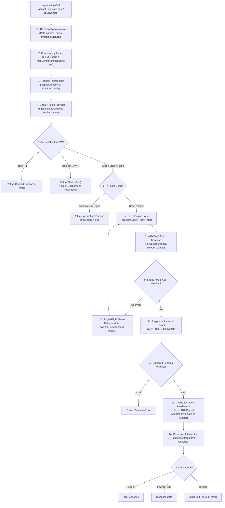

# react-native-fetch-client — Developer Documentation
 
Documentation for **`react-native-fetch-client`**, a Fetch-native HTTP client designed for **React Native, Expo, modern web browsers, and Node.js 18+**.
 
---
 
## Documentation Index
 
| Guide | Description |
| :--- | :--- |
| **[Architecture and Execution Flow](./architecture-flow.md)** | Step-by-step trace of how requests move through the execution pipeline. |
| **[Core Features and Usage Guide](./core-features-guide.md)** | Client initialization, HTTP methods, path params, form encoding, safe requests, polling, search auto-cancel, and latency tracking. |
| **[Caching and Stale-While-Revalidate](./caching-and-swr.md)** | In-memory LRU, persistent storage adapters (MMKV / AsyncStorage), ETag / 304, declarative invalidation, and SWR strategy. |
| **[Resilience, Retries, and Offline Queue](./resilience-and-offline.md)** | Exponential backoff, jitter, concurrency limiter, request deduplication, and offline replay queue. |
| **[Streaming, AI, and File Uploads](./streaming-and-uploads.md)** | Server-Sent Events (SSE), AI LLM token streams, WHATWG streams, file uploads, and upload/download progress metrics. |
| **[Authentication and Security](./auth-and-security.md)** | Bearer presets, single-flight 401 refresh mutex, proactive token expiry, token rotation, and header redaction. |
| **[Auto-Pagination Helper](./auto-pagination.md)** | Stream and collect paginated APIs (`page`, `offset`, `cursor`, and RFC 5988/8288 `Link` headers). |
| **[Testing and Mock Adapter](./testing-and-mocking.md)** | Zero-dependency declarative test mocking (`createMockAdapter`), route stubbing, error simulations, and history inspection. |
 
---
 
## Architecture Overview
 
`react-native-fetch-client` is designed around an execution pipeline where each concern (caching, deduplication, concurrency, authentication) is decoupled into standalone modules that orchestrate seamlessly:
 

 
---
 
## Key Design Principles
 
1. **Zero External Dependencies**:
   - Zero production dependencies (`dependencies: {}`).
   - Compact bundle footprint with dual ESM and CJS outputs.
2. **Native Mobile First**:
   - Operates natively on React Native's Hermes engine without legacy `XMLHttpRequest` bridges or polyfills.
   - Storage adapter interface integrates cleanly with native key-value storage engines such as MMKV and AsyncStorage.
3. **Resilience by Default**:
   - Concurrency limiting, deduplication, and exponential backoff are native primitives within the request pipeline.
4. **Strict Typing**:
   - Configured with TypeScript strict mode. Generics flow through URL resolution, schema validators, responses, and pagination helpers.

