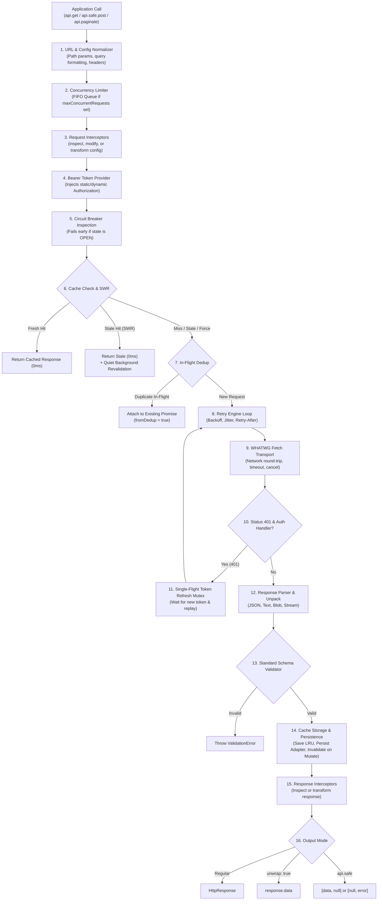

# react-native-fetch-client — Developer Documentation

Welcome to the comprehensive developer documentation for **`react-native-fetch-client`**, an enterprise-grade, Fetch-native HTTP engine engineered for **React Native, Expo, modern web browsers, Node.js 18+, and edge runtimes**.

---

## 🧭 Documentation Index

| Guide | Description |
| :--- | :--- |
| **[1. Architecture & Execution Flow](./architecture-flow.md)** | Comprehensive step-by-step trace of how requests move through the 16-stage pipeline. |
| **[2. Core Features & Usage Guide](./core-features-guide.md)** | Client initialization, HTTP methods, path params, form encoding, safe requests, polling, search auto-cancel, and latency tracking. |
| **[3. Caching & Stale-While-Revalidate](./caching-and-swr.md)** | In-memory LRU, persistent storage adapters (MMKV / AsyncStorage), ETag / 304, declarative invalidation, and SWR strategy. |
| **[4. Resilience, Retries & Offline Queue](./resilience-and-offline.md)** | Exponential backoff, jitter, circuit breaker, concurrency limiter, request dedup, and offline replay queue. |
| **[5. Streaming, AI & File Uploads](./streaming-and-uploads.md)** | SSE / AI LLM token streams, WHATWG streams, file uploads, and upload/download progress metrics. |
| **[6. Authentication & Security](./auth-and-security.md)** | Bearer presets, single-flight 401 refresh mutex, proactive token expiry, token rotation, and header redaction. |
| **[7. Auto-Pagination Helper](./auto-pagination.md)** | Stream and collect paginated APIs (`page`, `offset`, `cursor`, RFC 5988/8288 `Link` headers). |
| **[8. Testing & Mock Adapter](./testing-and-mocking.md)** | Zero-dependency declarative test mocking (`createMockAdapter`), route stubbing, error simulations, and history inspection. |

---

## 🏛️ High-Level System Architecture

`react-native-fetch-client` is designed around an execution pipeline where each concern (caching, deduplication, concurrency, circuit breaking, authentication) is decoupled into standalone modules that orchestrate seamlessly:

---

## ⚡ Key Architectural Advantages

1. **Zero External Dependencies**:
   * No `axios`, `cross-fetch`, `node-fetch`, or `lodash`.
   * Tiny bundle size (~25 KB minified, 8 KB gzip), minimal memory footprint.
2. **Native Mobile First**:
   * Runs natively on React Native's Hermes engine without polyfills or legacy `XMLHttpRequest` bridges.
   * Persistent storage hooks directly into high-speed native KV engines like **react-native-mmkv** and **AsyncStorage**.
3. **Enterprise Resilience Built-in**:
   * Concurrency limiting, circuit breaking, deduplication, and exponential backoff are native primitives, not loosely coupled plugins.
4. **Type Strictness**:
   * Built with TypeScript `exactOptionalPropertyTypes: true`. Generic types flow through URL resolution, schema validators, responses, and pagination.

