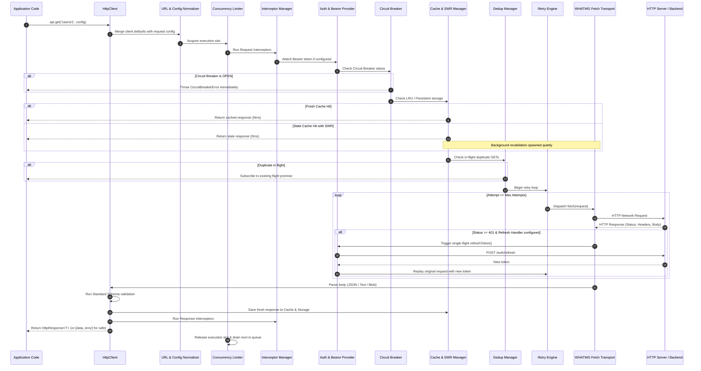

# Architecture & Execution Flow

This document details the complete end-to-end lifecycle of an HTTP request within **`react-native-fetch-client`**, from the initial call to final resolution.

---

## The 16-Stage Execution Pipeline

Every call (`api.get()`, `api.post()`, `api.safe.get()`, `api.request()`) is executed through a deterministic, ordered pipeline orchestrated in `src/executor.ts`:

---

## Stage-by-Stage Breakdown

### Stage 1: Client Entry & Options Merging
* **File Reference**: [`src/client.ts`](file:///Users/arunkumar.arjunan/Documents/PlayGround/react-native-fetch-client/src/client.ts), [`src/executor.ts`](file:///Users/arunkumar.arjunan/Documents/PlayGround/react-native-fetch-client/src/executor.ts)
* When you invoke `api.get(url, config)` or `api.post(url, body, config)`, the client delegates to `api.request({ ...config, url, method, body })`.
* Default client configurations (`baseURL`, `timeout`, `retry`, `cache`, `headers`) are merged with per-request overrides. Per-request overrides take precedence.
* **Cancellation Group Interception (`cancelPrevious`)**: If `cancelPrevious` is supplied, any existing in-flight request sharing the same group key is automatically aborted with `CancelError`.

### Stage 2: URL Normalization & Parameter Interpolation
* **File Reference**: [`src/url.ts`](file:///Users/arunkumar.arjunan/Documents/PlayGround/react-native-fetch-client/src/url.ts)
* **Path Parameter Replacement**:
  Tokens such as `/org/:orgId/users/{userId}` are matched against `config.pathParams = { orgId: 'acme', userId: 42 }` and interpolated to `/org/acme/users/42`.
* **BaseURL Resolution**:
  Relative paths are cleanly prepended with `baseURL`, ensuring no duplicated or missing slashes (`https://api.domain.com/v1` + `/users` -> `https://api.domain.com/v1/users`).
* **Query Parameter Serialization**:
  Arrays can be formatted using 4 RFC strategies:
  * `'brackets'`: `filter[]=a&filter[]=b`
  * `'indices'`: `filter[0]=a&filter[1]=b`
  * `'repeat'`: `filter=a&filter=b`
  * `'comma'`: `filter=a,b`

### Stage 3: Concurrency Throttling (FIFO Queue)
* **File Reference**: [`src/concurrency.ts`](file:///Users/arunkumar.arjunan/Documents/PlayGround/react-native-fetch-client/src/concurrency.ts)
* If `maxConcurrentRequests: N` is set (e.g., `maxConcurrentRequests: 2`), the client ensures no more than `N` requests are in-flight simultaneously.
* Excess requests are queued in a FIFO waiting list.
* As soon as an active request completes (whether resolved or rejected), the next task in the queue is automatically dequeued and executed.

### Stage 4: Request Interceptor Pipeline
* **File Reference**: [`src/interceptor.ts`](file:///Users/arunkumar.arjunan/Documents/PlayGround/react-native-fetch-client/src/interceptor.ts)
* Registered request interceptors run in the order they were attached (`api.interceptors.request.use(...)`).
* Each interceptor can modify headers, transform payloads, or reject with a custom error before any network packet is dispatched.

### Stage 5: Authentication & Bearer Provider
* **File Reference**: [`src/auth.ts`](file:///Users/arunkumar.arjunan/Documents/PlayGround/react-native-fetch-client/src/auth.ts)
* **Proactive Token Refresh**: If `isExpired` is configured and returns true, `refreshToken()` runs proactively before sending, avoiding an initial 401 error roundtrip.
* **Bearer Injection**:
  * Static string: `Authorization: Bearer <token>` is injected if not already present.
  * Async getter `() => Promise<string>`: Evaluates asynchronously per-request.

### Stage 6: Circuit Breaker Inspection
* **File Reference**: [`src/circuit-breaker.ts`](file:///Users/arunkumar.arjunan/Documents/PlayGround/react-native-fetch-client/src/circuit-breaker.ts)
* Checks the circuit state for the target host:
  * `CLOSED`: Normal operation. Request proceeds.
  * `OPEN`: Circuit tripped due to consecutive failures exceeding `failureThreshold`. Fails immediately with `CircuitBreakerError` (saves battery, cellular data, and avoids backend overload).
  * `HALF_OPEN`: Test period after `resetTimeoutMs`. One probe request is permitted to check backend recovery.

### Stage 7: Cache Check & Stale-While-Revalidate (SWR)
* **File Reference**: [`src/cache.ts`](file:///Users/arunkumar.arjunan/Documents/PlayGround/react-native-fetch-client/src/cache.ts), [`src/executor.ts`](file:///Users/arunkumar.arjunan/Documents/PlayGround/react-native-fetch-client/src/executor.ts)
* If the request is a cacheable method (`GET` or `HEAD`):
  * **Fresh Hit**: Returns cached `HttpResponse` instantly (0ms, `cached: true`).
  * **Stale Hit (SWR Strategy)**: If `strategy: 'stale-while-revalidate'`, returns stale response immediately (0ms, `cached: true, stale: true`) and quietly dispatches background revalidation. When background fetch finishes, `onRevalidated` triggers with fresh data (or `onRevalidationError` if it fails).
  * **ETag Validation**: If an ETag exists for the URL, the client attaches `If-None-Match: <etag>`. If the server returns `304 Not Modified`, the cached body is reused without re-downloading bytes.

### Stage 8: In-Flight Request Deduplication
* **File Reference**: [`src/dedup.ts`](file:///Users/arunkumar.arjunan/Documents/PlayGround/react-native-fetch-client/src/dedup.ts)
* If multiple components in a React component tree trigger identical GET calls simultaneously:
  * Request 1 initiates the network socket.
  * Request 2 and Request 3 subscribe to the identical in-flight promise.
  * When Request 1 resolves, all 3 receive the response simultaneously (`fromDedup: true` on secondary subscribers).

### Stage 9: Resilient Retry Loop
* **File Reference**: [`src/retry.ts`](file:///Users/arunkumar.arjunan/Documents/PlayGround/react-native-fetch-client/src/retry.ts)
* If network or server errors occur (`500`, `502`, `503`, `504`, `429`):
  * Calculates backoff delay (`delay * 2^attempt`).
  * Adds randomized `jitter` to prevent thundering herd.
  * Respects `Retry-After` response headers if present.
  * Retries only safe idempotent methods unless explicitly overridden.

### Stage 10: WHATWG Fetch Transport & Progress
* **File Reference**: [`src/parse.ts`](file:///Users/arunkumar.arjunan/Documents/PlayGround/react-native-fetch-client/src/parse.ts), [`src/executor.ts`](file:///Users/arunkumar.arjunan/Documents/PlayGround/react-native-fetch-client/src/executor.ts)
* Connects using `globalThis.fetch` (or custom `fetchImpl`).
* If `onUploadProgress` or `onDownloadProgress` is provided, requests and responses are monitored calculating loaded/total byte progress metrics.
* Supports caller abort via standard `AbortController.signal` or client `timeout`.

### Stage 11: Single-Flight 401 Token Refresh Mutex
* **File Reference**: [`src/auth.ts`](file:///Users/arunkumar.arjunan/Documents/PlayGround/react-native-fetch-client/src/auth.ts)
* If the server responds with `401 Unauthorized` and `auth.refreshToken` is configured:
  * All concurrent 401 requests pause behind an internal mutex.
  * Exactly **one** refresh network call is dispatched.
  * Once the new access token is obtained, all queued requests are updated with the new Authorization header and replayed.

### Stage 12: Body Parsing
* **File Reference**: [`src/parse.ts`](file:///Users/arunkumar.arjunan/Documents/PlayGround/react-native-fetch-client/src/parse.ts)
* Automatically determines response body format based on `responseType` option or `content-type` header:
  * `json`: Parsed JSON object/array (safely returns null on empty bodies).
  * `text`: Plain text string.
  * `blob`: Binary Blob.
  * `arrayBuffer`: ArrayBuffer binary buffer.
  * `stream`: Raw `ReadableStream<Uint8Array>`.

### Stage 13: Schema Validation
* **File Reference**: [`src/validator.ts`](file:///Users/arunkumar.arjunan/Documents/PlayGround/react-native-fetch-client/src/validator.ts)
* If `config.schema` is defined:
  * Evaluated against **Standard Schema Spec v1** (`~standard`), **Zod** (`.parse()`), **Valibot**, or custom validation functions.
  * If schema issues are found, execution halts and throws `ValidationError` with detailed issue paths and messages.

### Stage 14: Cache Storage & Mutation Invalidation
* **File Reference**: [`src/cache.ts`](file:///Users/arunkumar.arjunan/Documents/PlayGround/react-native-fetch-client/src/cache.ts)
* **Writing Cache**: Successful GET responses are saved in the in-memory LRU cache and serialized to `storage` (if persistent storage adapter is provided).
* **Automatic Invalidation**: Successful mutation requests (`POST`, `PUT`, `PATCH`, `DELETE`) automatically invalidate matching path cache entries.
* **Declarative Invalidation**: Custom routes or RegExp patterns listed in `cache.invalidate` are purged immediately upon mutation success.

### Stage 15: Response Interceptors
* **File Reference**: [`src/interceptor.ts`](file:///Users/arunkumar.arjunan/Documents/PlayGround/react-native-fetch-client/src/interceptor.ts)
* Registered response interceptors run sequentially (`api.interceptors.response.use(...)`), allowing global response transformations or unified error logging.

### Stage 16: Response Output Modes
* **Full Envelope**: Standard mode returns `HttpResponse<T>` containing `data`, `status`, `statusText`, `headers`, `durationMs`, `cached`, `stale`, and `fromDedup`.
* **Unwrap (`unwrap: true`)**: Direct resolution of `response.data`.
* **Safe Tuples (`api.safe.*`)**: Returns `[data, null]` on success or `[null, error]` on failure (Go / Rust style).

