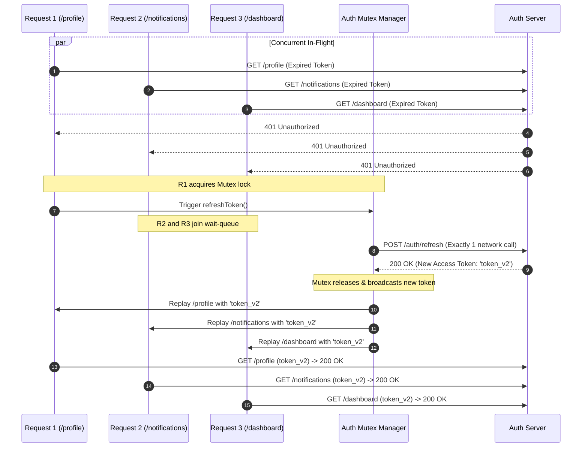

# Authentication and Security

This guide outlines authentication handling, token rotation, security headers, the single-flight 401 refresh mutex, and DevTools stealth mode in **`react-native-fetch-client`**.

---

## 1. Bearer Token Preset (`bearerToken`)

Attach authorization tokens without writing manual request interceptors.

### Static Token String
```typescript
import { createClient } from 'react-native-fetch-client';

const api = createClient({
  baseURL: 'https://api.example.com',
  bearerToken: 'auth_token_value',
});

// Outgoing requests automatically include:
// Authorization: Bearer auth_token_value
```

### Dynamic / Async Token Getter
When tokens are stored in secure device storage (e.g. `expo-secure-store`, `react-native-keychain`), supply an async function evaluated before each request:

```typescript
import * as SecureStore from 'expo-secure-store';

const api = createClient({
  baseURL: 'https://api.example.com',
  bearerToken: async () => {
    return await SecureStore.getItemAsync('user_session_token');
  },
});
```

---

## 2. Single-Flight 401 Token Refresh Mutex

### Overview
When an access token expires, concurrent requests (such as initial dashboard or tab queries) encounter 401 responses simultaneously. Without synchronization, each failed request triggers an independent `/auth/refresh` call. If the backend rotates refresh tokens on each call, subsequent refresh calls fail and invalidate the user session.

`react-native-fetch-client` queues concurrent requests behind an asynchronous mutex, ensuring only a single refresh request is dispatched:



### Configuration Example

```typescript
import { createClient } from 'react-native-fetch-client';
import * as SecureStore from 'expo-secure-store';

const api = createClient({
  baseURL: 'https://api.example.com',
  auth: {
    // 1. Invoked when a 401 response is received
    refreshToken: async () => {
      const currentRefreshToken = await SecureStore.getItemAsync('refresh_token');

      const response = await fetch('https://api.example.com/auth/refresh', {
        method: 'POST',
        headers: { 'Content-Type': 'application/json' },
        body: JSON.stringify({ refreshToken: currentRefreshToken }),
      });

      if (!response.ok) {
        // Refresh token expired: clear storage and prompt re-authentication
        await SecureStore.deleteItemAsync('access_token');
        await SecureStore.deleteItemAsync('refresh_token');
        throw new Error('Session expired. Please log in again.');
      }

      const { accessToken, newRefreshToken } = await response.json();
      await SecureStore.setItemAsync('access_token', accessToken);
      await SecureStore.setItemAsync('refresh_token', newRefreshToken);

      return accessToken;
    },

    // 2. Status codes triggering refresh (default: [401])
    refreshOn: [401],

    // 3. Excluded URLs to prevent recursive refresh loops
    refreshExcludeUrls: ['/auth/login', '/auth/refresh', '/auth/logout'],

    // 4. Header name and prefix configuration
    headerName: 'Authorization',
    tokenPrefix: 'Bearer ',
  },
});
```

### Proactive Token Refresh (`isExpired`)

By default, token refresh is reactive (triggered when an endpoint returns 401). If token expiration is tracked locally, provide `isExpired`. The client checks this before dispatching the request. If expired or within a safety buffer, `refreshToken()` runs proactively, avoiding the failed 401 network call:

```typescript
let tokenExpiresAt = Date.now() + 15 * 60 * 1000;

const api = createClient({
  baseURL: 'https://api.example.com',
  auth: {
    getToken: async () => await SecureStore.getItemAsync('access_token'),

    // Proactively refresh when less than 30 seconds remain
    isExpired: () => Date.now() > tokenExpiresAt - 30_000,

    refreshToken: async () => {
      const { token, expiresIn } = await fetchNewAccessToken();
      tokenExpiresAt = Date.now() + expiresIn * 1000;
      await SecureStore.setItemAsync('access_token', token);
      return token;
    },
  },
});
```

---

## 3. Universal DevTools Stealth Mode (`hideFromDevTools`)

For sensitive endpoints (such as payments, biometrics, credentials, or audit routes), `hideFromDevTools` prevents requests, headers, and response payloads from appearing in runtime debugging tools:

- **React Native (iOS and Android)**: Hooks React Native's internal `XHRInterceptor` to drop both request send callbacks and response delivery callbacks for matching endpoints. Requests remain invisible in Chrome Inspect (`chrome://inspect`), Hermes Debugger, and Flipper.
- **Console and Diagnostic Loggers**: Suppresses debug logging and error logging traces for matching requests.
- **Web Browsers**: Suppresses console and client-level logging (browser C++ network panels remain visible under W3C sandboxing rules).

### Usage

```typescript
// 1. Client-level configuration
const api = createClient({
  baseURL: 'https://api.example.com',
  // Match by boolean, string substrings, or RegExp patterns:
  hideFromDevTools: ['/auth', '/payment', /card-\d+/],
});

// Matching requests are suppressed from DevTools:
await api.post('/payment/charge', { cardToken: 'tok_secret' });

// 2. Request-level override
await api.get('/account/private-keys', {
  hideFromDevTools: true,
});
```

---

## 4. Security and Data Protection

### Automatic Credential Redaction
When debug logging is enabled (`debug: true` or custom logger), authorization headers (`Authorization: Bearer [REDACTED]`) and cookies are redacted automatically to prevent sensitive tokens from leaking into system logs or external monitoring platforms.

### Authenticated Cache Isolation
Requests containing an `Authorization` header are excluded from caching by default (`allowAuthenticated: false`). This prevents user-specific data from persisting across sessions or being served to a different user after logout.

When authenticated caching is explicitly enabled:

```typescript
const api = createClient({
  baseURL: 'https://api.example.com',
  cache: {
    enabled: true,
    allowAuthenticated: true,
  },
});
```

Cache keys are automatically partitioned by authorization tokens: `GET:/profile|auth:Bearer_tokenA` is stored separately and cannot be retrieved by `Bearer_tokenB`.
