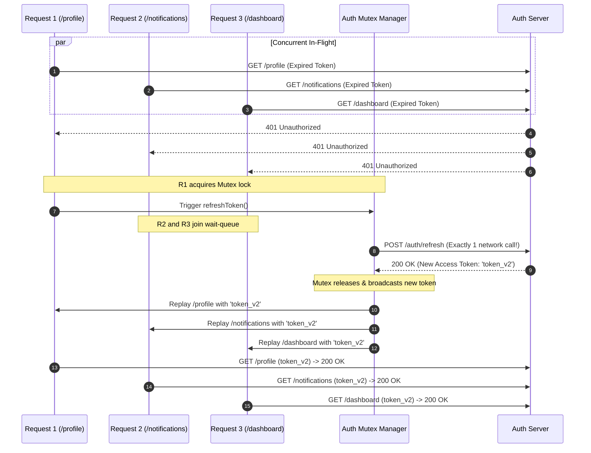

# Authentication & Security

This guide outlines authentication handling, token rotation, security headers, and the single-flight 401 refresh mutex in **`react-native-fetch-client`**.

---

## 🔑 1. Bearer Token Preset (`bearerToken`)

Avoid writing repetitive request interceptors just to attach an `Authorization: Bearer <token>` header:

### Static Token String
```typescript
import { createClient } from 'react-native-fetch-client';

const api = createClient({
  baseURL: 'https://api.example.com',
  bearerToken: 'rnfc_sec_token_9981',
});

// All requests automatically include:
// Authorization: Bearer rnfc_sec_token_9981
```

### Dynamic / Async Getter Function
If the token is stored in native secure storage (e.g. `expo-secure-store`, `react-native-keychain`), supply an async function that evaluates before each request:

```typescript
import * as SecureStore from 'expo-secure-store';

const api = createClient({
  baseURL: 'https://api.example.com',
  bearerToken: async () => {
    return await SecureStore.getItemAsync('user_session_token');
  },
});
```

---

## 🔄 2. Single-Flight 401 Token Refresh Mutex

### The Problem
When a user's access token expires, multiple parallel requests (e.g. loading user profile, notifications, and dashboard stats) often fire at the exact same moment.
In traditional clients, each failing request triggers its own `/auth/refresh` request independently. The first refresh rotates the refresh token, causing all subsequent refresh requests to fail or invalidate the session.

### The Solution: Single-Flight Mutex
`react-native-fetch-client` queues all concurrent requests behind an internal asynchronous mutex:



### Implementation Example
```typescript
import { createClient } from 'react-native-fetch-client';
import * as SecureStore from 'expo-secure-store';

const api = createClient({
  baseURL: 'https://api.example.com',
  auth: {
    // 1. Function executed when a 401 is encountered
    refreshToken: async () => {
      const currentRefreshToken = await SecureStore.getItemAsync('refresh_token');

      const response = await fetch('https://api.example.com/auth/refresh', {
        method: 'POST',
        headers: { 'Content-Type': 'application/json' },
        body: JSON.stringify({ refreshToken: currentRefreshToken }),
      });

      if (!response.ok) {
        // Refresh token itself has expired: throw to trigger user logout
        await SecureStore.deleteItemAsync('access_token');
        await SecureStore.deleteItemAsync('refresh_token');
        throw new Error('Session expired. Please log in again.');
      }

      const { accessToken, newRefreshToken } = await response.json();
      await SecureStore.setItemAsync('access_token', accessToken);
      await SecureStore.setItemAsync('refresh_token', newRefreshToken);

      return accessToken; // New token returned to client
    },

    // 2. HTTP status codes that trigger a refresh (Default: [401])
    refreshOn: [401],

    // 3. URLs that should NEVER trigger refresh (prevents infinite refresh loops)
    refreshExcludeUrls: ['/auth/login', '/auth/refresh', '/auth/logout'],

    // 4. Header name and prefix customization
    headerName: 'Authorization',
    tokenPrefix: 'Bearer ',
  },
});
```

### ⚡ Proactive Token Refresh (`isExpired`)

By default, token refresh is **reactive**—the client waits for the backend to return `401 Unauthorized` before pausing requests and invoking `refreshToken()`.

If your tokens contain expiration timestamps or you maintain session expiry locally, you can provide `isExpired`. The client checks this *before* dispatching the request. If the token is already expired or within a safety buffer (e.g. 30 seconds before expiry), `refreshToken()` runs proactively, avoiding the failed 401 roundtrip completely:

```typescript
let tokenExpiresAt = Date.now() + 15 * 60 * 1000; // 15-minute token

const api = createClient({
  baseURL: 'https://api.example.com',
  auth: {
    getToken: async () => await SecureStore.getItemAsync('access_token'),

    // Proactively refresh if less than 30 seconds remain
    isExpired: () => Date.now() > tokenExpiresAt - 30_000,

    refreshToken: async () => {
      const { token, expiresIn } = await fetchNewAccessToken();
      tokenExpiresAt = Date.now() + expiresIn * 1000;
      await SecureStore.setItemAsync('access_token', token);
      return token;
    },
  },
});
```

---

## 🛡️ 3. Security & Data Protection

### Automatic Token Redaction in Debug Logs
When `debug: true` or a custom logger is enabled, the client automatically redacts sensitive authorization credentials (`Authorization: Bearer [REDACTED]`) before logging to prevent accidental leakage in device logs or telemetry services.

### Authenticated Cache Isolation
By default, requests containing an `Authorization` header are **never cached** (`allowAuthenticated: false`). This prevents sensitive user data from being accidentally served to a different user profile after logout.

If you intentionally enable authenticated caching:
```typescript
const api = createClient({
  baseURL: 'https://api.example.com',
  cache: {
    enabled: true,
    allowAuthenticated: true, // Partition cache keys by Authorization header
  },
});
```
The client isolates the cache entry per-token:
`GET:/user/account|auth:Bearer_tokenA` is never accessible by `Bearer_tokenB`.

