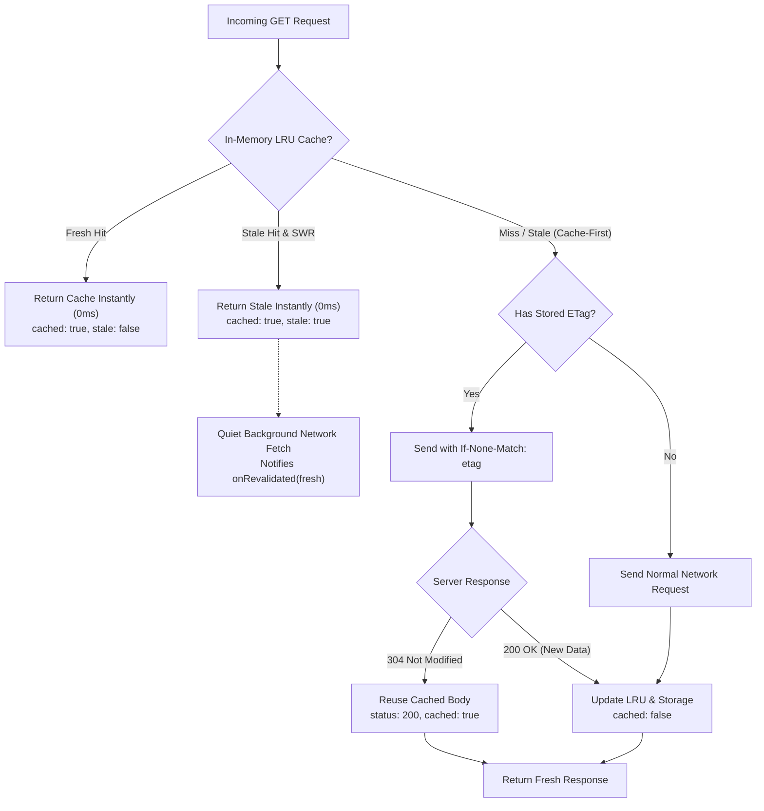

# Caching & Stale-While-Revalidate (SWR)

This guide explains the dual-tier caching engine in **`react-native-fetch-client`**: high-speed in-memory LRU caching, persistent mobile storage adapters, RFC 7234 conditional validation (ETag/304), and Stale-While-Revalidate (SWR).

---

## Overview of Caching Tiers



---

## 1. In-Memory LRU Cache

Enable in-memory LRU caching during client creation:

```typescript
import { createClient } from 'react-native-fetch-client';

const api = createClient({
  baseURL: 'https://api.example.com',
  cache: {
    enabled: true,
    defaultTtl: 60_000, // 60 seconds TTL
    maxSize: 100, // Max 100 entries before LRU eviction
    methods: ['GET', 'HEAD'], // Safe methods only
    allowAuthenticated: false, // Disallow caching if Authorization header exists
  },
});
```

### Cache Key Partitioning

Cache keys are deterministically generated from:
`METHOD:PATHNAME?SORTED_QUERY_PARAMS`

When `allowAuthenticated: true` is configured, the cache key partitions per-user authorization token to prevent data leakage between user sessions:
`GET:/user/profile|auth:Bearer_xyz123`

---

## 2. Persistent Storage Adapters (`CacheStorageAdapter`)

In mobile applications, in-memory caches are wiped when the operating system kills the background process. `react-native-fetch-client` supports pluggable key-value storage adapters so responses survive cold app boots.

### Pluggable Interface

```typescript
export interface CacheStorageAdapter {
  getItem(key: string): Promise<string | null> | string | null;
  setItem(key: string, value: string): Promise<void> | void;
  removeItem(key: string): Promise<void> | void;
  clear?(): Promise<void> | void;
}
```

### React Native MMKV Adapter (Recommended for Mobile)

```typescript
import { MMKV } from 'react-native-mmkv';
import { createClient, type CacheStorageAdapter } from 'react-native-fetch-client';

const mmkv = new MMKV({ id: 'http-cache' });

const mmkvAdapter: CacheStorageAdapter = {
  getItem: (key) => mmkv.getString(key) ?? null,
  setItem: (key, value) => mmkv.set(key, value),
  removeItem: (key) => mmkv.delete(key),
  clear: () => mmkv.clearAll(),
};

const api = createClient({
  baseURL: 'https://api.example.com',
  cache: {
    enabled: true,
    storage: mmkvAdapter,
    storageKey: 'mobile_http_cache_v1',
    defaultTtl: 300_000, // 5 minutes
  },
});
```

### AsyncStorage Adapter

```typescript
import AsyncStorage from '@react-native-async-storage/async-storage';
import { createClient, type CacheStorageAdapter } from 'react-native-fetch-client';

const asyncStorageAdapter: CacheStorageAdapter = {
  getItem: (key) => AsyncStorage.getItem(key),
  setItem: (key, value) => AsyncStorage.setItem(key, value),
  removeItem: (key) => AsyncStorage.removeItem(key),
  clear: () => AsyncStorage.clear(),
};
```

### Hydration & Cold Boot

When `storage` is passed to `cache`, the client automatically calls `api.cache.hydrate()` in the background to restore valid, non-expired cache entries into memory:

```typescript
// Explicitly await hydration if your splash screen requires warm data:
await api.cache.hydrate();

// Immediate hit from storage (0ms, cached: true)!
const profile = await api.get('/user/profile');
```

### Storage Sanitization (CWE-312)

When serializing cached responses to persistent storage (`setItem`), sensitive response headers such as `Set-Cookie`, `Set-Cookie2`, and `Authorization` are automatically stripped before writing to disk, ensuring that unencrypted storage files (e.g. AsyncStorage or MMKV) never retain plaintext session cookies.

---

## 3. Stale-While-Revalidate (SWR Strategy)

The SWR strategy renders cached data **instantly (0ms latency)**, while silently fetching the latest version from the server in the background:

### Global Configuration

```typescript
const api = createClient({
  baseURL: 'https://api.example.com',
  cache: {
    enabled: true,
    strategy: 'stale-while-revalidate',
  },
});
```

### Usage with Revalidation Callback

```typescript
// First call: Warm up cache
await api.get('/posts/1');

// Subsequent call:
const response = await api.get<Post>('/posts/1', {
  cache: {
    strategy: 'stale-while-revalidate',
    onRevalidated: (updatedResponse) => {
      console.log('Background sync complete! Updated data:', updatedResponse.data);
      // Update UI state with fresh data
      setPost(updatedResponse.data);
    },
    onRevalidationError: (err) => {
      console.warn('Background revalidation failed, keeping stale data:', err);
    },
  },
});

console.log(response.cached); // true
console.log(response.stale); // true (served instantly!)
```

---

## 4. RFC 7234 Conditional Validation (`ETag` & `304 Not Modified`)

Enabled by default when caching is active:

1. When a server responds with an `ETag` (e.g. `ETag: "v1-abcdef"`), the client records it alongside the cached body.
2. On subsequent expired requests, the client adds `If-None-Match: "v1-abcdef"`.
3. If the backend resource has not changed, the server returns `304 Not Modified` with an empty body.
4. The client automatically catches the 304 and synthesizes a full `200 OK` response using the cached payload, saving bandwidth and battery.

```typescript
// Bypass or force revalidation on a per-request basis
const fresh = await api.get('/inventory', {
  cache: { etag: true, skip: false },
});
```

---

## 5. Mutation Invalidation & Cache Management

The client exposes programmatic cache controls on `api.cache`:

```typescript
// Inspect cache
console.log(api.cache.size); // Number of active cached entries
console.log(api.cache.has('GET:/posts'));

// Invalidate specific key
api.cache.delete('GET:/posts');

// Invalidate by regex or prefix pattern
api.cache.deletePattern(/^GET:\/users/); // Clears all /users routes

// Clear entire cache
api.cache.clear();

// Persist in-memory state to storage adapter manually
await api.cache.persist();
```

### Automatic Mutation Invalidation

When an update or deletion occurs via `POST`, `PUT`, `PATCH`, or `DELETE`, the client automatically invalidates related cached GET routes for the matching resource path to prevent stale data displays.

### Declarative Invalidation (`invalidate`)

Updating a single resource (e.g. `PUT /users/42`) won't automatically know to invalidate collection queries (like `/users` or `/users?page=1`). Use `cache.invalidate` to declare related routes to purge upon mutation success:

```typescript
// Mutate single entity and purge associated lists from cache:
await api.put(
  '/users/42',
  { name: 'Alice' },
  {
    cache: {
      invalidate: ['/users', '/dashboard/members'], // Accepts exact path strings or RegExp patterns
    },
  },
);
```

---

## 6. Non-Cacheable & Sensitive Endpoints (Payments, Orders & Live Polling)

Mission-critical transactions (such as payment status verification, checkout workflows, wallet balances, and OTP checks) must **never** serve cached or stale data. Serving a stale response for a payment check can cause duplicate debits or false cancellations.

### Built-in Guardrails
1. **Unsafe Methods are Never Cached**: Requests using `POST`, `PUT`, `PATCH`, or `DELETE` strictly bypass the cache 100% of the time.
2. **Authenticated Isolation**: By default (`allowAuthenticated: false`), any request with an `Authorization` header is excluded from cache storage.

### Explicit Per-Request Cache Bypass
For `GET` payment checks or live status queries, explicitly disable both cache and in-flight deduplication:

```typescript
const paymentStatus = await api.get(`/payments/${txnId}/status`, {
  cache: false, // 🛑 Bypasses cache completely — guarantees fresh server data
  dedup: false, // 🛑 Bypasses in-flight dedup — ensures every attempt reaches the wire
});
```

### Polling Payment Status with `api.poll()`
When waiting for asynchronous payment confirmation (e.g. 3D-Secure, UPI, Stripe webhooks), combine `api.poll()` with fresh request policies:

```typescript
const result = await api.poll<{ status: 'PENDING' | 'SUCCESS' | 'FAILED' }>(
  `/payments/${txnId}/status`,
  {
    interval: 2000, // Poll every 2 seconds
    timeout: 60000, // Stop after 60 seconds
    validate: (res) => res.data.status === 'SUCCESS' || res.data.status === 'FAILED',
    requestConfig: {
      cache: false, // Force fresh network check on every attempt
      dedup: false,
    },
  },
);
```

