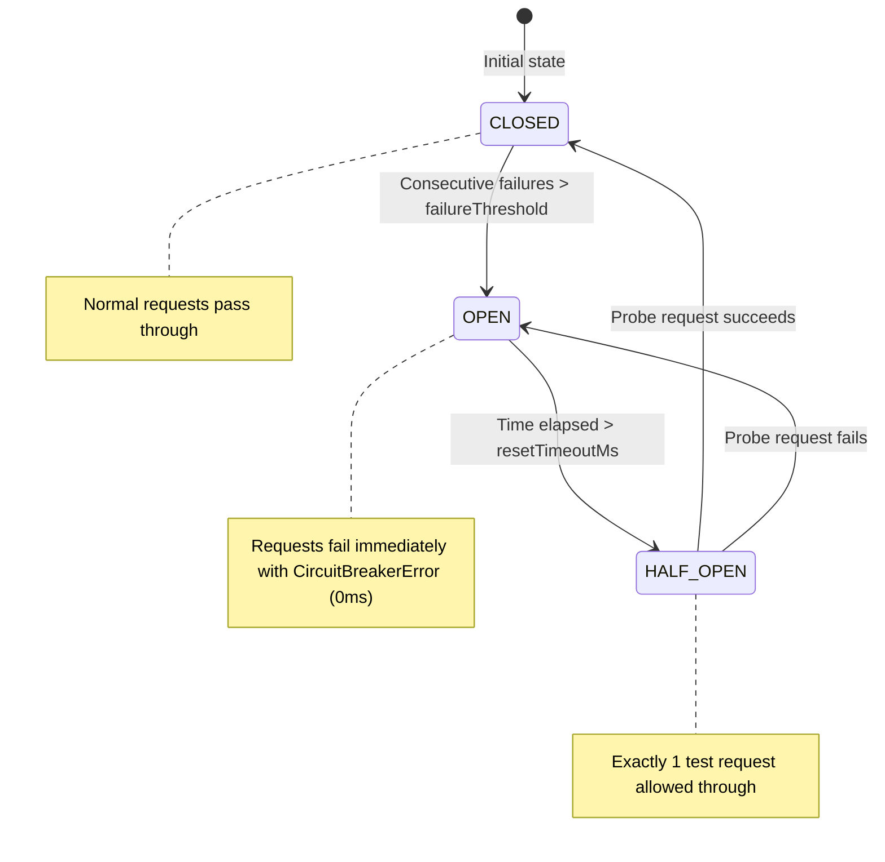
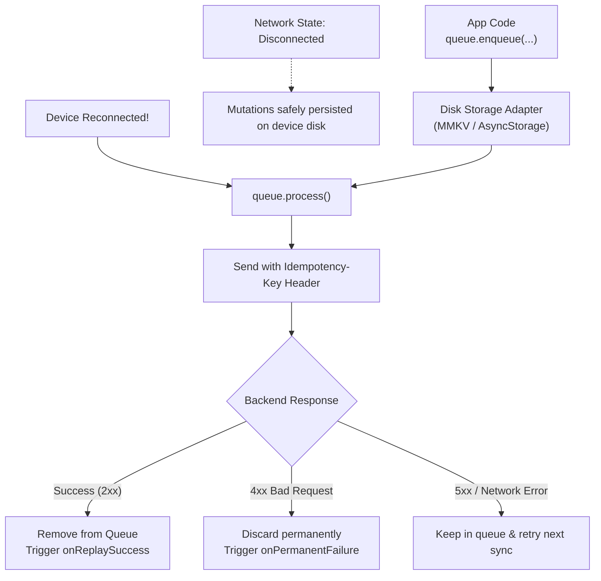

# Resilience, Retries & Offline Queue

This guide explores the enterprise reliability and offline mechanics in **`react-native-fetch-client`**: smart exponential backoff retries, jitter, circuit breaking, request deduplication, concurrency throttling, and the persistent offline queue.

---

## 1. Smart Retry Engine

Network requests on mobile devices frequently encounter transient connection drops or rate limits (`429 Too Many Requests`). The built-in retry engine automatically handles temporary network turbulence.

### Configuration
```typescript
import { createClient } from 'react-native-fetch-client';

const api = createClient({
  baseURL: 'https://api.example.com',
  retry: {
    attempts: 3,                  // Maximum 3 retries after initial failure
    backoff: 'exponential',        // 'exponential' or 'linear'
    delay: 1000,                  // Base delay in ms (1s)
    maxDelay: 15_000,             // Cap maximum wait to 15s
    jitter: true,                 // Adds random offset to avoid thundering herd
    retryOn: [429, 500, 502, 503, 504], // Status codes eligible for retry
    safeMethods: ['GET', 'HEAD', 'PUT', 'DELETE'], // Safe idempotent methods
    respectRetryAfter: true,      // Respects Retry-After header sent by server
  },
});
```

### Exponential Backoff & Jitter
* **Without Jitter**: Requests 1, 2, and 3 wait `1000ms`, `2000ms`, `4000ms`. If 10,000 mobile clients disconnect at the same time, they all retry simultaneously, crashing the server.
* **With Jitter (`jitter: true`)**: A random multiplier (`delay * 2^attempt * (0.5 + Math.random() * 0.5)`) is applied to distribute server traffic smoothly.

### Custom Retry Predicate
```typescript
const customRetry = await api.get('/orders', {
  retry: {
    attempts: 4,
    retryCondition: (error, attempt) => {
      // Don't retry if user is not authenticated
      if (isHttpError(error) && error.status === 401) return false;
      return attempt < 4;
    },
  },
});
```

---

## 2. Circuit Breaker Pattern

The Circuit Breaker prevents an application from repeatedly dispatching doomed requests to an unavailable backend, saving battery, device CPU, and network data.



### Setup & Usage
```typescript
const api = createClient({
  baseURL: 'https://api.example.com',
  circuitBreaker: {
    enabled: true,
    failureThreshold: 5,   // Trip circuit after 5 consecutive failures
    resetTimeoutMs: 30_000 // Wait 30 seconds before testing recovery
  },
});

try {
  await api.get('/heavy-computation');
} catch (err) {
  if (isCircuitBreakerError(err)) {
    console.warn(`Circuit is OPEN for host ${err.host}. Backend is down; request halted locally!`);
  }
}
```

---

## 3. Concurrency Throttler (`maxConcurrentRequests`)

Prevent bandwidth congestion and connection starvation on mobile by limiting simultaneous HTTP connections:

```typescript
const api = createClient({
  baseURL: 'https://api.example.com',
  maxConcurrentRequests: 3, // Maximum 3 concurrent active sockets
});

// Trigger 15 requests simultaneously:
// - Requests 1, 2, 3 run immediately
// - Requests 4 through 15 wait in a FIFO queue
// - As soon as #1 finishes, #4 starts automatically
const promises = Array.from({ length: 15 }, (_, i) => api.get(`/items/${i}`));
await Promise.all(promises);
```

---

## 4. In-Flight Request Deduplication (`dedup`)

Deduplication coalesces concurrent identical `GET` requests into a single network flight. If 5 components on a screen all request `/users/me` on mount:

```typescript
const api = createClient({
  baseURL: 'https://api.example.com',
  dedup: {
    enabled: true,
    methods: ['GET', 'HEAD'],
  },
});

// Executed concurrently from different components:
const [res1, res2, res3] = await Promise.all([
  api.get('/users/me'),
  api.get('/users/me'),
  api.get('/users/me'),
]);

console.log(res1.fromDedup); // false (primary network flight)
console.log(res2.fromDedup); // true  (shared subscriber)
console.log(res3.fromDedup); // true  (shared subscriber)
// Total network sockets opened: exactly 1!
```

---

## 5. Persistent Offline Mutation Queue

The Offline Queue buffers mutating requests (`POST`, `PUT`, `PATCH`, `DELETE`) while a mobile device is disconnected, persisting them to disk, and systematically replaying them when connectivity is restored.

### Queue Architecture



### Implementation Guide
```typescript
import {
  createClient,
  createOfflineQueue,
  type OfflineQueueStorage,
} from 'react-native-fetch-client';
import { MMKV } from 'react-native-mmkv';

const storage = new MMKV({ id: 'offline-queue' });

const queueStorageAdapter: OfflineQueueStorage = {
  getItem: (key) => storage.getString(key) ?? null,
  setItem: (key, value) => storage.set(key, value),
  removeItem: (key) => storage.delete(key),
};

const api = createClient({ baseURL: 'https://api.example.com' });

const queue = createOfflineQueue({
  client: api,
  storage: queueStorageAdapter,
  onReplaySuccess: (item, response) => {
    console.log(`Replayed ${item.method} ${item.url} successfully! (Key: ${item.idempotencyKey})`);
  },
  onPermanentFailure: (item, error) => {
    console.error(`Request ${item.id} failed permanently and was discarded:`, error);
  },
});

// 1. Enqueue mutation while offline
const item = await queue.enqueue({
  url: '/notes',
  method: 'POST',
  body: { title: 'Offline Note', content: 'Captured while in airplane mode' },
});
console.log(`Enqueued with ID: ${item.id}`);

// 2. Process queue when device comes back online (e.g. NetInfo listener)
const summary = await queue.process();
console.log(`Replay complete: ${summary.succeeded} succeeded, ${summary.remaining} remaining.`);
```

### Automatic Idempotency Keys
Every enqueued request automatically receives an RFC-compliant `Idempotency-Key` header (`uuid-v4` format). Even if an offline replay is interrupted by a brief disconnect, the server can safely deduplicate the request without creating duplicate records.

---

## 5. Smart Polling Engine (`api.poll`)

Long-running backend operations (such as payment verification, export jobs, or AI inference tasks) often require polling an endpoint until a terminal state is reached. Rather than managing manual `setInterval` timers, cleanup handles, and error counters, `api.poll()` wraps polling in a resilient, declarative method.

### Example: Polling an Export Job
```typescript
import { createClient } from 'react-native-fetch-client';

const api = createClient({ baseURL: 'https://api.example.com' });

interface JobStatus {
  id: string;
  status: 'pending' | 'processing' | 'completed' | 'failed';
  downloadUrl?: string;
}

try {
  const result = await api.poll<JobStatus>('/jobs/exp_9981', {
    interval: 1500,     // Poll every 1.5 seconds
    timeout: 30_000,    // Fail if not resolved in 30 seconds
    backoff: 'linear',  // 'fixed' | 'linear' | 'exponential'
    maxInterval: 5000,  // Cap maximum polling delay
    until: (res) => res.data.status === 'completed' || res.data.status === 'failed',
  });

  if (result.data.status === 'completed') {
    console.log('Export ready:', result.data.downloadUrl);
  } else {
    console.error('Job failed remotely');
  }
} catch (err) {
  if (isTimeoutError(err)) {
    console.warn('Polling exceeded 30 seconds without reaching terminal status (hanging requests aborted).');
  } else if (isCancelError(err)) {
    console.warn('Polling was cancelled by caller signal.');
  }
}
```

> [!NOTE]
> `api.poll()` guarantees that in-progress network requests are cleanly aborted if the overall `timeout` is reached, preventing orphaned sockets. Additionally, aborting an `options.signal` during an inter-request delay immediately interrupts the delay without waiting for the timer to elapse.

### Polling Options Reference

| Option | Type | Default | Description |
| :--- | :--- | :--- | :--- |
| `interval` | `number` | `1000` | Delay in milliseconds between consecutive poll attempts |
| `timeout` | `number` | `30000` | Maximum total duration in milliseconds before rejecting with `TimeoutError` |
| `until` | `(response: HttpResponse<T>) => boolean` | *(required)* | Predicate function returning `true` when polling should finish successfully |
| `backoff` | `'fixed' \| 'linear' \| 'exponential'` | `'fixed'` | Growth rate applied to `interval` across consecutive poll attempts |
| `maxInterval` | `number` | `10000` | Upper ceiling limit on polling interval delay |
| `signal` | `AbortSignal` | `undefined` | Optional cancellation signal to abort polling prematurely |


